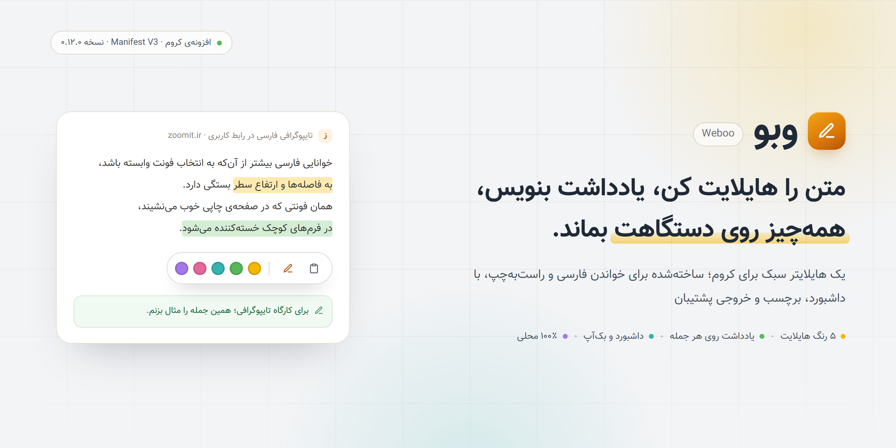
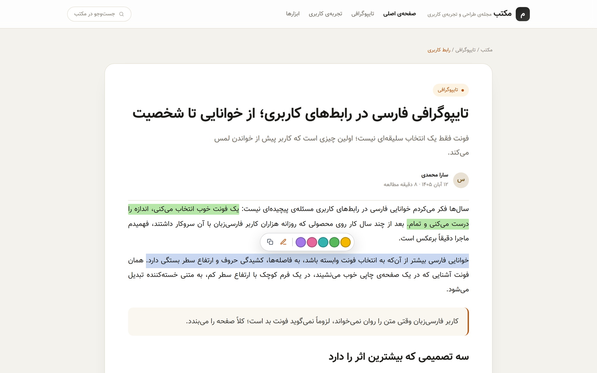
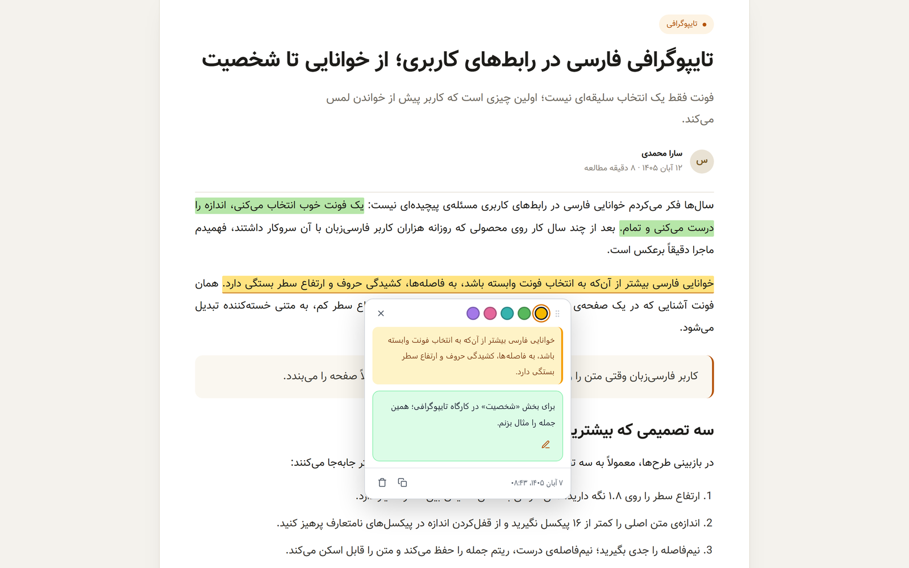
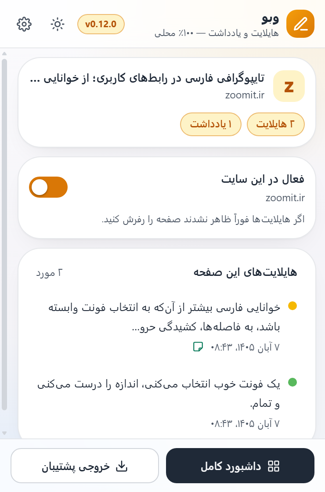
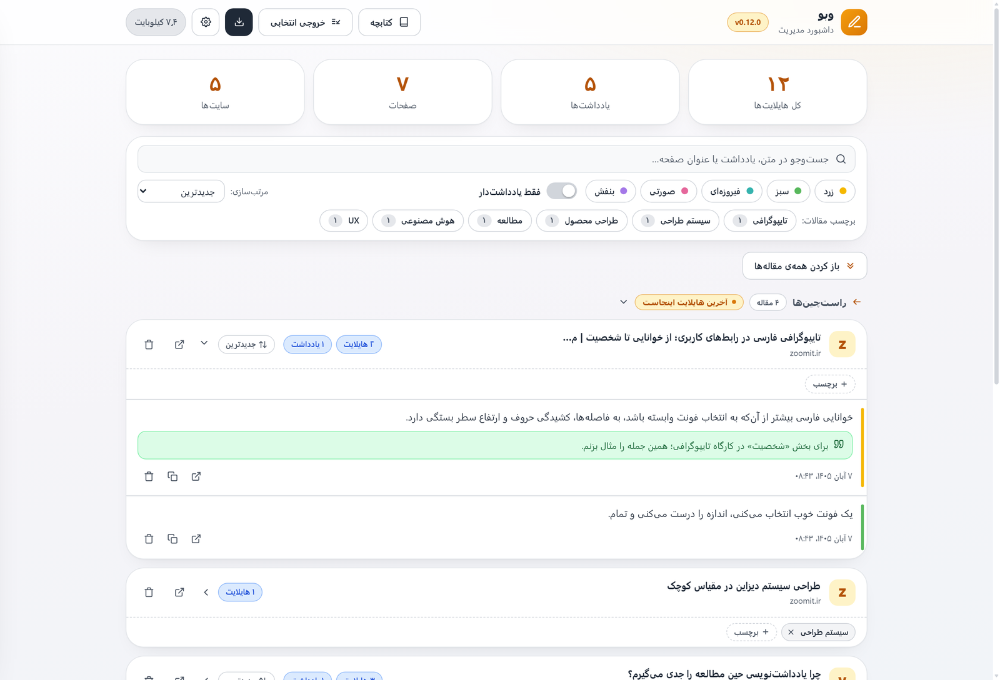
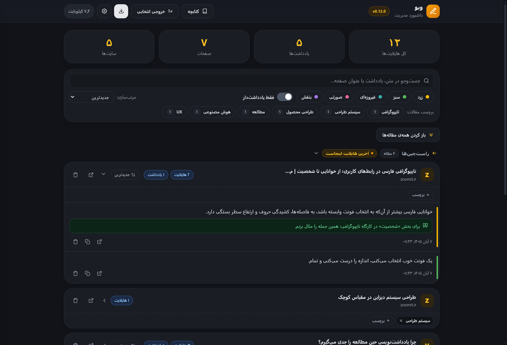
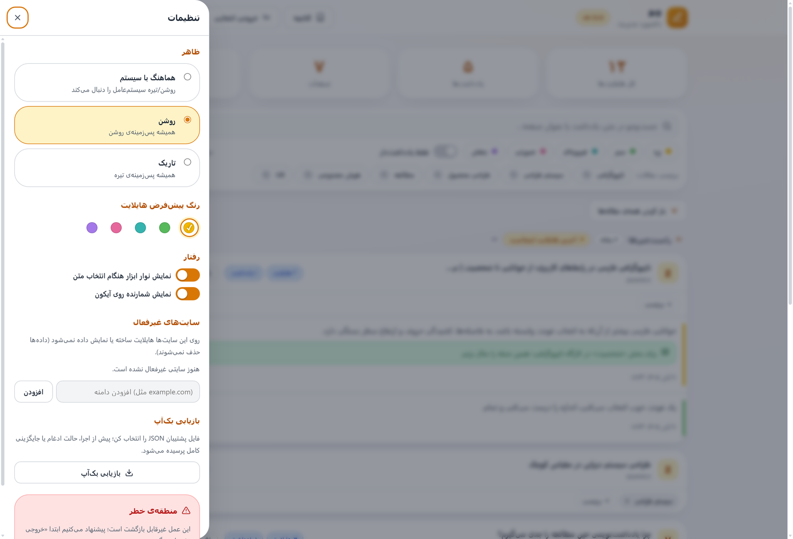
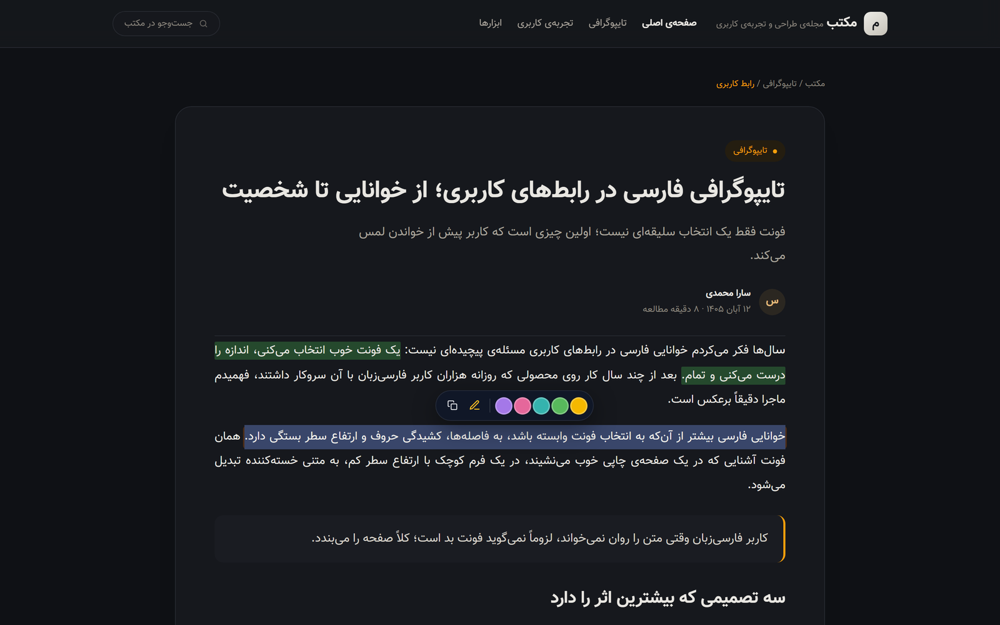

# Weboo

[فارسی](README.fa.md) | **English**

<p align="center">
  
</p>

Weboo (وبو) is a Chrome extension for people who read a lot on the web and
forget most of it. Select a sentence on any page, mark it with one of five
colors, and add a note when the reason for saving it is not obvious. Weeks
later, the dashboard still has it, with a link back to the exact paragraph.

The interface is Persian and RTL by design, since that is the reading
experience it was built for, but it behaves the same on English and other LTR
pages.

There is no server, no account, and no analytics. Highlights live in the
browser's local storage, on your machine, and nothing about the pages you read
is sent anywhere.

## What it does

| Feature | Details |
| --- | --- |
| **Five highlight colors** | Yellow, green, teal, pink and purple. Pick a color from the floating toolbar, the right-click menu, or with `Alt+Shift+H`. |
| **Notes on highlights** | Click a highlight to open its card. A note shows up underlined in the article and in the dashboard. |
| **Article tags** | Up to eight tags per article, for keeping a reading list organized. |
| **Dashboard** | Search, filter by color, tags or notes, sort, collapse groups, and jump back to the source paragraph. |
| **Backups** | Export a full JSON backup or a selective one (only some sites, articles or tags). Restore asks whether to merge or replace. |
| **Reading exports** | A Markdown library for Obsidian or any editor, and a printable booklet with a table of contents. |
| **Themes** | Auto, light and dark. The in-page widgets switch with the theme immediately. |
| **Per-site switch** | Turn Weboo off on a given site without deleting the highlights already saved there. |
| **Badge counter** | Optional count of highlights on the extension icon. |

## Screenshots

Selecting text brings up the color toolbar. The highlight stays after a reload,
and clicking it opens the note card.

<p>
  
</p>
<p>
  
</p>

The popup shows what is saved on the current page, and the gear opens the
dashboard.

<p>
  
</p>

The dashboard gathers everything. Light and dark themes are both first-class.

<p>
  
</p>
<p>
  
</p>

Settings live in a drawer on the same page: theme, default color, toolbar and
badge toggles, disabled sites, backup restore.

<p>
  
</p>

On dark pages, highlights and widgets follow the theme.

<p>
  
</p>

## Install

Weboo is not on the Chrome Web Store. You install it from the release archive
in this repository.

Requirements: Chrome 102 or newer, or any Chromium-based browser that accepts
unpacked extensions.

1. Download `dist/weboo-v0.12.0.zip` (or the newest `weboo-v*.zip`).
2. Unzip it into a folder you can keep, for example `Documents/weboo`.
3. Open `chrome://extensions`.
4. Turn on **Developer mode** in the top corner.
5. Click **Load unpacked** and select the unzipped folder.

The extension appears in the toolbar. Open any article, select a sentence, and
the toolbar shows up next to the selection.

> The `extension/` folder in this repository is source code, not a loadable
> build. Chrome will refuse it with `Could not load options page
> 'dashboard.html'`. That is expected: use the release zip, or build the
> extension yourself with `bun run build:wxt` and load `.output/chrome-mv3`.

## Using it

**Highlighting.** Select text with the mouse. The toolbar opens above it with
six colors, a note button and a copy button. Pick a color and the highlight is
saved immediately. Right-clicking a selection offers the same action, and
`Alt+Shift+H` applies your default color without opening the toolbar.

**Notes.** Click a highlight to open its card. The card shows the quoted text,
the date, and a note field. Notes can be edited or removed later. The card also
has copy and delete actions.

**The popup.** The toolbar icon opens a list of highlights for the current
page, with a count of notes. The switch at the top disables Weboo for that host
only. The gear opens the dashboard.

**The dashboard.** Every highlight is grouped by article, with the site and
favicon. You can search inside highlight text and notes, filter by color, show
only highlights that have notes, filter by tag, collapse groups, and open the
original paragraph in a new tab.

**Backups.** In the dashboard, «خروجی پشتیبان» exports everything as one JSON
file. «خروجی انتخابی» lets you include only certain sites, articles or tags.
Restoring merges into what you already have or replaces it, whichever you pick.

**Exports.** «خروجی Markdown» writes the whole library into one Markdown file
with YAML front matter on top, one section per article, ready to drop into an
Obsidian vault. «کتابچه» builds a booklet from the articles you select, with a
table of contents, for printing or saving as PDF.

**Settings.** Theme (auto, light, dark), default highlight color, whether the
floating toolbar appears, whether the badge counter is shown, and the list of
sites where the extension is disabled.

## Privacy

Weboo stores highlights with `chrome.storage.local`. The keys are partitioned
per site, so reading one site's highlights does not scan the others:

```
hlx:settings          user settings (theme, default color, disabled sites)
hlx:d:<host>          highlights for one host
hlx:f:<host>          favicon captured from the page, stored as a data URL
hlx:tags              article tags, keyed by normalized URL
hlx:schemaVersion     storage shape version, used by migrations
```

Nothing is uploaded. The only outbound request the extension can make is
fetching a page's own favicon from that page's origin, and the result is stored
locally as an image. There is no remote endpoint anywhere in the code.

Because everything is local, uninstalling the extension deletes your
highlights. Export a backup first if the reading list matters to you.

## How it works

The extension is Manifest V3, written in TypeScript, built with WXT and React.

- A content script runs on `http` and `https` pages. Its modules are bundled in
  the order declared by the manifest, and a build check fails if the order ever
  drifts.
- Each highlight is stored with a structural anchor (two XPath expressions plus
  offsets) and the text around it. On reload the anchor is resolved again; if
  the DOM has changed, the stored prefix and suffix are used to find the quote
  again, and the anchor is repaired quietly.
- The dashboard is a React page over a small external store with optimistic
  writes and rollback. The backup selection rule and the booklet selection rule
  are pure functions, shared between the preview and the exported file.
- Storage is versioned with forward only migrations. Unknown fields in stored
  records and imported backups are preserved, so a newer version's data does
  not get flattened by an older one.

The `docs/` folder goes deeper on [architecture](docs/architecture.md),
[storage](docs/storage.md), [the anchor engine](docs/anchor-engine.md) and
[benchmarks](docs/benchmarks.md).

## Development

Prerequisites: [Bun](https://bun.sh) 1.4.2 (pinned in `package.json`), Node.js
for the packaging scripts, and a Chromium build for the real-browser tests.

```bash
bun install
bun run build:wxt     # WXT build into .output/chrome-mv3, then the parity check
bun run zip           # type emit, WXT build, parity check, dist/weboo-v<version>.zip
bun run test          # unit suite (bun:test + happy-dom)
bun run lint          # eslint
bun run typecheck     # tsc --noEmit
bun run harness       # rebuild the popup E2E harness
```

The real-browser tests drive Chrome over the DevTools protocol. Point
`HLX_CHROME` at a Chromium binary:

```bash
HLX_CHROME=<chromium> bun tests/e2e/real-theme-e2e.mjs    # theme cycle in the popup, live re-theming on the page
HLX_CHROME=<chromium> bun tests/e2e/next-compat-e2e.mjs   # SPA navigation and remounts
HLX_CHROME=<chromium> bun tests/e2e/real-backup-e2e.mjs   # selective backup and the restore flow
HLX_CHROME=<chromium> bun tests/e2e/real-booklet-e2e.mjs  # booklet picker, table of contents, fonts
HLX_CHROME=<chromium> bun tests/e2e/real-favicon-e2e.mjs  # favicon capture
```

The unit suite covers the storage layer, the anchoring engine, exports, the
popup and dashboard data pipelines, theme contrast floors and the package shape.

## Repository layout

```
entrypoints/          WXT entrypoints (background, content bundle, dashboard)
extension/            product source, copied into the build as-is
  content/            content script, mark styles, favicon capture
  shared/             anchoring, storage, exports, UI widgets
  popup/              popup page (MVC)
  dashboard/          dashboard data pipeline and stylesheet
src/                  TypeScript sources (compiled into extension/shared)
  dashboard/          React dashboard
  types/              domain models, pinned to the runtime by contract tests
scripts/              build, packaging, icon generation, parity checks
tests/                unit suite and real-Chrome CDP tests
docs/                 architecture, storage, anchoring, benchmarks
```

## Versioning and releases

Every change ships with a version bump: patch for fixes, minor for features,
major for breaking changes. The version lives in five places that are kept in
sync, four of which are pinned by the packaging test.

Release zips stay in `dist/` permanently. They are the release history of the
project, including the older `highlighter-extension-*` archives from before the
v0.8.0 rename to Weboo.

Publishing a release is one command — a version tag:

```bash
git tag v0.12.0 && git push origin v0.12.0
```

The tag must equal the version in `extension/manifest.json` (bump all five
places first). Pushing it triggers the `release` workflow: frozen install, the
full gate (typecheck, lint, tests, build + parity), the zip build, a
tag/manifest/ZIP consistency check, then a GitHub Release with the installable
ZIP attached beside GitHub's automatic source archives. If a run fails, open it
under Actions — the failing step names the cause: a version mismatch, a failed
gate, or an existing release for that tag.

## Credits

Weboo is designed and built by [Mahdi Imeni](https://github.com/mahdiimeni),
including the v0.12 "Air" redesign.

## License

[MIT](LICENSE).
